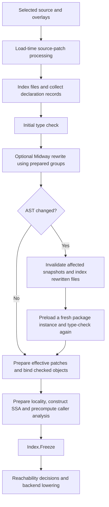

# Compiler directive records

`internal/directive` owns recognition and source records for Go and LLGo compiler
directives. Each compilation owns one `directive.Index`. The coordinator prepares
its metadata before backend workers start; backend Programs share Go metadata and
keep separate LLVM contexts, modules, target machines and lowering caches.

The central rule is that source declarations are identified by their AST nodes,
checker objects and `types.Package` instance. Neither an import path nor a linker
symbol identifies a declaration uniquely. Prepared records are authoritative,
including a declaration with no annotation and a name absent from that package.

## Data and ownership

| Data | Identity / contents | Owner and consumers |
| --- | --- | --- |
| `Index` | File, comment-group and function-property caches; discovery state | One compilation; shared by loading, preparation, analyses and lowering |
| `File` | An `*ast.File`, group associations, function properties, embed-comment recognition, source-patch commands, internal directives | Loader and source preparation |
| `Group` | Active `Items`, conservative `Bindings`, function flags, legacy skip information and parsed embed patterns/errors | Directive collection, Midway, locality, embed and reachability checks |
| `Package` | Declaration maps by source node, canonical name and checked object | One `*types.Package`; normal, alternate and effective patch packages have distinct records |
| `FunctionDecl` | Source declaration, canonical name, links/exports and source properties | Function association, callable resolution and body analysis |
| `VariableDecl` / `TypeDecl` | Variable links/exports; type `CallConv` and positioned deprecation warning | Global creation, layout and type conversion |
| `sourceFunction` | Concrete SSA function plus its source `FunctionDecl` | Per-lowering-context association cache; generic instances use their origin declaration |
| `packageSyntaxData` | Package records, effective-package mapping and compatibility indexes | Coordinator and backend Programs share this Go-owned state |

`File.Syntax` and declaration `Source` fields retain AST identity; they are not
copies of the entire syntax tree. Derived properties are snapshots. A source
rewrite must retire affected snapshots before subsequent consumers use the new
AST view. After preparation, consumers must not mutate records or the AST.

## Compilation lifecycle

1. **Select source.** Source-patch discovery consumes load-time `llgo:skip` /
   `llgo:skipall` commands before checking. Neutralizing consumed commands preserves
   byte offsets and line endings. Reparsed overlays have distinct AST identities.
2. **Prepare syntax metadata.** The loader and build driver share the Program's
   Index. `cl.ParsePkgSyntaxWithOptions` validates internal-directive trust,
   declaration placement and link/type annotations, then publishes package
   records. This happens before checking because calling conventions and locality
   metadata can affect frontend behavior.
3. **Handle typed rewrites.** Midway uses the same Index for global-binding
   validation, copying embed annotations and removing external bindings from
   generated function variants. If rewriting succeeds and changes the AST,
   `internal/packages` invalidates the old file/group/function snapshots, indexes
   the rewritten files, creates a fresh `types.Package` and `types.Info`, invokes
   preload again and performs the second check. Generated declarations therefore
   participate in the same collector. There is no backend repair or late rescan.
4. **Associate checked objects.** `Package.Bind` joins declaration records with
   `types.Info.Defs`. Effective patch packages collect original and alternate
   syntax and bind both checker views. Replaced declarations cannot override the
   active canonical-name entry. Binding finishes before worker publication.
5. **Finish analysis preparation.** Locality preparation and SSA construction can
   introduce synthetic functions. Caller tracking precomputes its function
   properties after SSA construction and before freezing the Index.
6. **Freeze discovery.** `Index.Freeze()` rejects discovery of unknown files,
   groups and functions, and rejects `Invalidate`. Existing entries remain
   readable. This is a discovery boundary, not a general-purpose write barrier
   around every exported metadata object: `Package.Bind` and Program metadata
   setters must obey the preparation-before-workers lifecycle.
7. **Consume records.** Reachability decisions and lowering read the prepared
   view. Backend Programs share the metadata but allocate fresh LLVM-owned state.

When the rewrite callback reports no change, cached records remain. When it
reports a change, the loader retires the package syntax view (all of its files);
the callback reports a package-level change flag. `Invalidate` is an explicit
source-rewrite operation, not a cache-miss fallback, and is forbidden after freeze. Rewriting failure leaves the package invalid and outside the loader's
successful-package cache.

## Lookup rules

### Source properties and effective call targets

Function source identity and callable identity have different jobs:

- `context.sourceFunction` associates an SSA body with its source declaration.
  Generic instances share the origin's declaration. No-inline/no-split flags,
  closure environments, wasm imports and body analyses use this association.
- `callableDeclaration` selects an effective patch declaration when resolving a
  call target. It does not replace the source record attached to the SSA body.
- A package keeps `Functions` for source-node identity and `Names` for the active
  canonical declaration. `Objects` binds surviving checker declarations. This
  preserves both original bodies and effective replacement declarations.
- Synthetic wrappers use explicit propagation rules. A promoted-method wrapper
  does not inherit an embedded method's linkname solely because its SSA object
  points at that method. Bound/thunk symbol naming preserves the receiver package
  identity supplied by main.

### Declaration and type queries

`Program.LinknameFor` resolves through the effective package's records: normalize
generic function objects to their origin, try object identity, then the canonical
name. When records exist, an absent declaration or link returns no annotation.
Only packages without records consult the string compatibility index.

Type calling conventions use the same rule through `packageSyntaxData.typeCallConv`.
Named types and aliases use their origin `TypeName`, then the effective package
record. This applies consistently to `Sizeof`/`Offsetsof`, Go-type conversion,
LLVM type creation, native struct layout and stdcall checks. A source-free
`SetTypeCallConv` entry cannot erase the extra Go closure word from an ordinary
function alias when its package records say otherwise.

Native struct preparation also registers source field identifier positions before
type checking, including embedded fields, so `Offsetsof` can recover the native
layout context from its field-only input. Registering prepared native type records
sets the shared metadata-presence flag used by the layout fast path, including
records installed directly and consumed through an effective patch package.

`go:nointerface` queries likewise use the effective method record. Source body
properties remain independent of this effective ABI/interface view.

### Reachability and compatibility indexes

Wasm runtime elimination resolves both callee and global bindings with
`LinknameFor`; its source-declaration scan uses checked object identity where
available. An unrelated compatibility entry such as `C.printf` must not turn an
unknown external call into an accepted allocation-free native boundary.
Unused-global-initializer analysis uses the same source-aware lookup for outgoing
aliases, and prepared groups to retain one-name `go:linkname` exports.

String indexes still serve source-free runtime symbols, alias chains and
linker-wide facts. For example, an incoming linkname target can keep a global
alive, and export symbols can keep a Windows test entry alive. These aggregate
linker queries have a different purpose from querying a particular source
declaration. The public compatibility setters remain available; they cannot
override source-aware lookup results when package records exist.

## Spelling, attachment and diagnostics

Central ownership does not force every consumer to accept the same spelling.
The records preserve the language's existing distinctions:

- `Group.Items` contains active normalized directives. `Group.Bindings` contains
  conservative external-binding hints for reachability and source rewriting,
  including whitespace forms such as tab-separated export hints. These hints do
  not activate an otherwise unsupported declaration directive.
- Source-patch commands can apply anywhere in patch files; legacy declaration
  skip rules retain their trailing-comment behavior. Import skip spelling still
  consumes the last comment as before.
- Link collection validates LLGo attachment and receiver-name matching, then
  applies package-wide Go links in source order under the existing unsafe-import
  rule. Local receiver aliases, pointer aliases and cross-file alias chains
  normalize to canonical method names without losing source spelling.
- `llgo:cdecl` and `llgo:stdcall` populate `TypeDecl.CallConv`. Legacy
  `llgo:type C/stdcall` records a positioned deprecation warning for preparation
  to emit. Arguments, conflicts and grouped declarations keep their diagnostics;
  field and TypeSpec comments retain their existing ignored behavior.
- Embed records retain parsed patterns and errors. The embed consumer still owns
  placement/type checks and resource loading. Locality similarly retains its
  semantic validation and lowering responsibilities.

Recognition can preserve an error for its original diagnostic phase rather than
reporting it prematurely. Source-order precedence, exact nointerface spelling,
internal-directive trust and C-package export naming remain intact.

## Compiler entrypoints and scope

All `cl.NewPackage*` entrypoints require prepared package records. Direct callers
collect root and required source-dependency records using
`ParsePkgSyntaxWithOptions`, bind checker information, finish caller analysis and
freeze before backend work. A missing root record produces an explicit error.
There is no `PreloadedSyntax` branch, imported-file text parser/cache or standalone
function-declaration fallback.

`internal/testsyntax` and `cl/cltest` adapt tests whose importer supplies only
exported objects: they load build-selected dependency syntax and bind objects to
those records. Tests owning dependency bodies prepare and bind the actual ASTs.
This adaptation is outside the production Index and does not restore implicit
preparation in compiler entrypoints.

Cgo preambles, `#cgo`, `go:cgo_ldflag`, `go:cgo_import_dynamic` and platform-specific
import/link handling stay in their existing paths. General function/variable
link/export records are shared compiler infrastructure; an explicit `C.` variable
binding still selects native storage. Runtime-source admission and ownership
audits remain independent source-review operations. This refactor adds no new
attribute families or LLVM optimization policy.

## Behavioral coverage

The regression suite checks source properties after comment mutation, concurrent
frozen reads, rejection of unprepared discovery/invalidation, package variants
with the same import path, effective patches and generic/alias origins. Typed
rewrite tests verify updated annotations and generated declarations before the
second preload, and embedded variants load from the refreshed frozen records.

Consumer-level regressions verify alias sizes with authoritative/absent package
records, effective alias ABI overrides, Wasm runtime decisions with stale versus
prepared external links, and global-initializer retention for prepared aliases.
They test observable layout or analysis decisions, not only successful record
lookup. Main's callback, variadic-wrapper, SIMD/FMV, debugger and finalizer tests
continue through the prepared compiler entrypoints.
